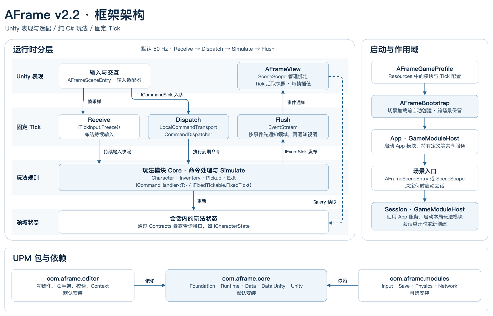
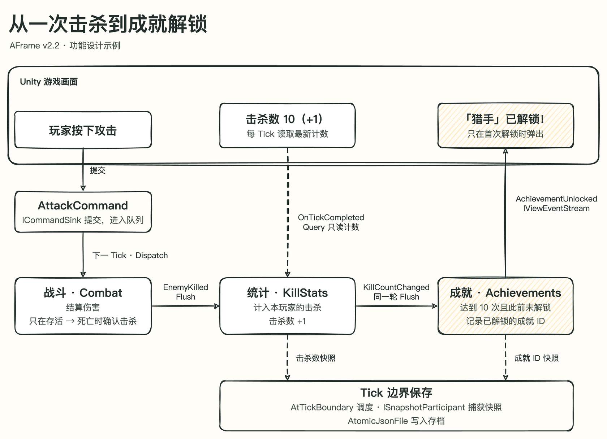

# AFrame

AFrame 是面向小型单机游戏的 **Unity 6.6 模块化框架**。用纯 C# 写玩法规则，用 Unity 做输入、场景和表现。清晰的功能边界和任务检查也方便 AI 在指定范围内修改代码。

## 架构图



[可编辑 draw.io](Docs/architecture/aframe-v2.2-overview.drawio) · [SVG](Docs/architecture/aframe-v2.2-overview.svg)

- **一局游戏怎么启动？** Bootstrap 读取 Profile，启动跨场景保留的 App。开局时创建 Session，重开时重新创建 Session。
- **状态怎么更新？** Session 默认每秒推进 50 次。在每次 Tick 中冻结持续输入、执行到期命令、推进玩法，再分发事件。
- **画面怎么更新？** 视图通过 Query 读取持续状态，例如位置和计数。一次性的弹窗和特效用事件触发。

## 从击杀到成就解锁

第 10 次击杀将计数从 9 更新为 10，并首次解锁「猎手」。这个设计示例展示如何用现有 AFrame 接口接入战斗、击杀统计和成就模块。



[可编辑 draw.io](Docs/architecture/aframe-kill-achievement.drawio) · [SVG](Docs/architecture/aframe-kill-achievement.svg)

攻击命令先入队。战斗模块在下一次 Tick 确认击杀，统计和成就模块依次处理事件。Tick 结束后，HUD 读取新计数。需要存档时，一起保存击杀数和已解锁的成就 ID。

## 快速开始

### 运行仓库自带的示例

克隆仓库后，在项目根目录运行 `git lfs pull` 获取 2D 示例使用的精灵资源。用 **Unity 6000.6.9f1** 打开项目，选择一个场景进入 Play Mode。

| 场景 | 怎么玩 | 能看到什么 |
| --- | --- | --- |
| [Character 2D](Assets/Game/Scenes/Character2D.unity) / [Character 3D](Assets/Game/Scenes/AFrameSampleScene.unity) | WASD 或方向键移动，Tab 切换视图 | 同一套角色规则驱动 2D 的 XY 平面和 3D 的 XZ 平面 |
| [能源回收站](Assets/Game/Scenes/EnergyStation.unity) | 点击「开始」，WASD 移动，Shift 冲刺，在 45 秒内收集三枚核心并进入出口 | 拾取、背包、关卡状态、暂停和存档如何协作 |

能源回收站支持 **Esc** 暂停或继续、**R** 重开、**F5** 保存。在主菜单按 **L** 或选择「读取存档」可继续上次进度。存档位于 `Application.persistentDataPath/AFrame/energy-station.json`。

### 安装到已有 Unity 项目

关闭目标项目的 Unity 编辑器，在 AFrame 仓库根目录用 Python 3 运行安装脚本。

```sh
python3 Tools/install-aframe "/你的 Unity 项目路径"
```

打开目标项目，选择 **AFrame → Initialize Project**，再打开生成的 `Assets/Game/Scenes/AFrameStart.unity` 进入 Play Mode。

| UPM 包 | 用途 | 如何安装 |
| --- | --- | --- |
| `com.aframe.core` | 基础类型、运行时、定义数据和 Unity 适配 | 默认安装 |
| `com.aframe.editor` | 初始化、脚手架、导入、校验和 Context | 默认安装 |
| `com.aframe.modules` | 存档工具与输入、物理、联机接口 | 加 `--modules` |

想把示例也装进目标项目，可以用 `--sample`。它会安装 Modules 并复制示例，需要未被占用的 `Assets/Game`。试玩前在 **Player → Active Input Handling** 选择 **Both**。

### 从旧分包升级

关闭 Unity，备份并移出旧的 `Packages/com.aframe.*` 目录，包括旧 Editor。再从目标项目的 `Packages/manifest.json` 移除对应条目，然后运行新版安装脚本。已有示例或引用可选模块的项目使用 `--modules`，保留原来的 `Assets/Game`。原有程序集名称和脚本 GUID 继续使用。

## 开发一个功能

1. 用 **AFrame → Generate → Feature** 创建骨架。先在 `Contracts` 定义命令、事件和查询，再到 `Core` 实现规则。跨功能协作使用对方的 `Contracts`。
2. 用 `Unity` 适配输入和视图，在 `Composition` 装配模块，通过 Profile 或场景入口启动。可调参数放进 `Definitions/*.aframe.json`，例如[角色移动速度](Assets/Game/Features/Character/Definitions/character.default.aframe.json)。
3. 更新 `Context/` 并校验。目录里有场景、程序集依赖和公共 API，可作为 AI 开始修改前的项目索引。

```sh
Tools/aframe import
Tools/aframe context
Tools/aframe validate
Tools/aframe smoke --scene Assets/Game/Scenes/EnergyStation.unity
```

给 AI 分配任务时，用 `Tasks/*.task.json` 写明目标、允许修改的路径和验收项。修改前运行 `Tools/aframe task start <id>` 记录基线，完成后运行 `Tools/aframe check --task <id>`。检查结果输出到 `Logs/AFrame/`。

## 设计与验收

- [v2.2 设计与迁移记录](Docs/AFrame-Architecture-v2.2.md)
- [v2.2 首版验收清单](Docs/AFrame-v2.2-Acceptance.md)
- 架构图和功能示例的呈现方式参考 [QFramework README](https://github.com/liangxiegame/QFramework#qframework-简介-intro)。
